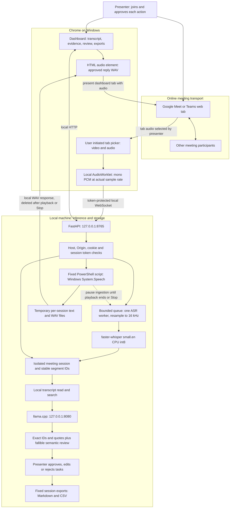

# Architecture

Captured video is retained only to keep Chrome's sharing session alive; no frames are processed, rendered, recorded, saved or sent. Captured audio never connects to browser speakers. Eight-second ASR windows overlap by one second; backlog and dropped intervals are visible. Stop invalidates queued/in-flight results before a new capture can accept them.

The model has transcript read/search context only. It receives no shell, network, email, calendar, browser or arbitrary-file tool. Ask/Update are explicit button actions. The backend validates exact citations and separately asks the same local model to review semantic support. That review can be wrong, so presentation and export remain subject to human review.

Speech requires a selected visible answer and explicit approval. Windows writes a WAV; the dashboard plays it, allowing the meeting's tab-audio presentation to carry the reply. The server pauses ASR ingestion during output and records the omitted interval. Meeting audio travels through the online meeting service; model inference, transcript state and generated reports stay local.
