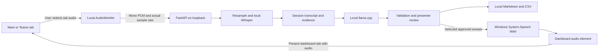

# AICK Local Agent

A Windows meeting assistant with a local dashboard, offline speech recognition, local language-model inference, evidence-backed answers, reviewed action items and presenter-approved speech.

**Google Meet and Microsoft Teams web in Chrome.** A human joins the agent browser as a visible attendee and the host admits it. The presenter chooses which tab to capture and approves each spoken reply. Meet/Teams carry the online call; inference and storage stay on your PC.

This is a working prototype, **not production-ready**. Exact citations do not prove that a model claim is true. Review the evidence and any warnings before speaking or exporting.

## What it does

- Captures user-selected meeting **tab audio** through Chrome's sharing picker, with an input meter, Stop control, latency and visible dropped-audio warnings.
- Transcribes explicitly uploaded PCM WAV files or live tab audio using local faster-whisper **small.en, CPU/int8, four threads**. Source labels and segment timestamps remain visible; speakers are never inferred.
- Retrieves transcript evidence, proposes an answer/action board, validates exact segment IDs and quotations, and presents a fallible semantic review. Unknown owners/dates remain unresolved; corrections and contradictions require review.
- Lets the presenter edit, approve or reject tasks while retaining original evidence and an audit history. Exports approved reports to local Markdown and CSV.
- Generates WAV speech with an installed Windows System.Speech voice and plays it in the dashboard tab. Listening pauses during output to avoid transcribing the reply.

No sign-in automation, hidden attendance, undocumented meeting API, virtual microphone, cloud bot, remote model inference, browser cloud speech API or automatic model download is implemented. There is no email/calendar/task-system integration.

## Architecture



See [ARCHITECTURE.md](ARCHITECTURE.md) for component boundaries and the speech/listening interlock.

## Requirements

| Component | Requirement |
|---|---|
| OS/browser | Windows with Windows PowerShell 5.1, System.Speech and Google Chrome |
| Python | 64-bit Python **3.12**; reviewed with 3.12.10 |
| Python packages | Install the pinned `requirements.txt`; preserve **PyAV 16.1.0** |
| ASR model | A complete local CTranslate2 **faster-whisper-small.en** directory |
| Language model | Local llama.cpp server with a chat-capable GGUF model; reviewed using Qwen2.5-7B-Instruct Q4_K_M |
| Speech voice | At least one enabled Windows System.Speech voice |
| Node.js | Optional, **24+**, for JavaScript unit tests only; no npm packages/build step |

Model weights and llama.cpp binaries are **not included**. Obtain them separately from their maintainers and review their licenses. Hardware must accommodate the selected LLM, Whisper and the browser together; CPU model speed depends on the machine. No GPU is required for Whisper.

## Download and install

Use **Code → Download ZIP** on GitHub and extract it, or clone:

```powershell
git clone https://github.com/chetankerhalkar/aick-local-agent.git
Set-Location aick-local-agent
py -3.12 -m venv .venv
& .\.venv\Scripts\python.exe -m pip install -r requirements.txt
Copy-Item -LiteralPath .\config.example.json -Destination .\config.json
```

The explicit install command downloads Python dependencies. The running application does not install dependencies or download models. For an offline install, provide a compatible wheel directory and use `pip install --no-index --find-links <wheel-directory> -r requirements.txt` instead.

### 1. Put the models on disk

Obtain the CTranslate2 model files from [Systran/faster-whisper-small.en](https://huggingface.co/Systran/faster-whisper-small.en/tree/main). Place `model.bin`, `config.json`, `tokenizer.json` and `vocabulary.txt` in `models/whisper-small.en/`. All four files must be real model files, not Git LFS pointer text. Do not place the original PyTorch Whisper checkpoint there. See the [faster-whisper documentation](https://github.com/SYSTRAN/faster-whisper).

For the reviewed LLM, obtain both Q4_K_M GGUF shards from [Qwen/Qwen2.5-7B-Instruct-GGUF](https://huggingface.co/Qwen/Qwen2.5-7B-Instruct-GGUF/tree/main), keeping their original filenames together in `models/`. The example configuration points to the first shard. A different compatible local model can be configured, but its extraction accuracy must be assessed separately.

### 2. Start llama.cpp locally

Obtain a Windows build from the [official llama.cpp releases](https://github.com/ggml-org/llama.cpp/releases). Keep its accompanying DLLs with the executable, for example under `bin/llama/`. From the repository directory, run this in a separate PowerShell terminal:

```powershell
& .\bin\llama\llama-server.exe `
  -m .\models\qwen2.5-7b-instruct-q4_k_m-00001-of-00002.gguf `
  --alias aick-local --host 127.0.0.1 --port 8080 `
  --ctx-size 8192 --parallel 1 --n-gpu-layers 0
```

Use a server build that provides `/health`, `/apply-template`, `/tokenize` and `/v1/chat/completions` with JSON response format. The application needs server tokenization to enforce its input budget. Keep the model's chat template enabled. See the [server documentation](https://github.com/ggml-org/llama.cpp/blob/master/tools/server/README.md) for build-specific options. No `-hf` or remote model URL is needed: the command reads local GGUF files.

Check that the model has finished loading:

```powershell
Invoke-RestMethod http://127.0.0.1:8080/health
```

### 3. Configure and launch the dashboard

Edit `config.json` if you used different paths or a different model alias. Relative `asr_model_path` resolves beside the configuration file. Set `speech_voice` to an enabled installed voice name, or leave it empty to use the Windows default. `llm_model_path` is recorded as runtime identity; llama.cpp itself is launched separately with `-m`.

```powershell
$env:MEETING_PREP_CONFIG = (Resolve-Path -LiteralPath .\config.json).Path
$env:PYTHONDONTWRITEBYTECODE = '1'
& .\.venv\Scripts\python.exe -m uvicorn app:app --host 127.0.0.1 --port 8765
```

Open **http://127.0.0.1:8765** in Chrome. Use that exact address: other Host values, including `localhost`, are rejected. Keep both server terminals running. Ctrl+C stops each server. Do not use multiple Uvicorn workers: sessions and worker admission are local process state.

The dashboard checks real llama.cpp health, local Whisper files and the installed voice. Whisper initializes lazily on the first audio job. Expected initial state: three ready services, an empty transcript, empty outcomes and capture off. `MEETING_PREP_CONFIG` is the supported configuration override; no original development/preparation folder is needed.

## Use it in a meeting

1. Manually join Meet or Teams web in Chrome as the visible agent attendee. Have the host admit it and follow the meeting's recording/transcription expectations.
2. In AICK, click **Listen to meeting**. Select **Chrome Tab → the meeting tab**, enable **Share tab audio**, then Share. The picker is required every time. If no audio track is supplied, all acquired tracks stop and the dashboard explains how to retry.
3. Speak from a second device/participant. Tab capture hears the meeting's received audio, not the local laptop microphone by itself. Check the meter and source-labeled transcript. Stop releases all tracks and clears queued audio.
4. Click **Ask agent** or **Update action board**. Open the evidence and workflow trace. Review owner/date/status fields and any omitted-context or contradiction warnings.
5. For speech, use the meeting's presentation control to share **the AICK dashboard tab with audio**. This is a separate picker selection from capturing the meeting tab. Select a visible answer, approve its exact text, then click **Speak reply**. If Chrome blocks autoplay, click the visible **Play reply** control. **Stop speaking** ends playback. Confirm reception from a second device.
6. Edit, approve or reject tasks in Presenter task review. Saving an edit removes its approval. Stop capture, then **Export approved meeting report**. Reports are written under `exports/<session-id>/` with citations, supported decisions, approved tasks, open questions, a draft follow-up and labeled audit history. Nothing is sent externally.

You can also add typed segments or explicitly upload a WAV without joining a meeting. Uploaded audio is labeled **Uploaded audio**, never live meeting audio. WAV limits: 25 MiB, 180 seconds, mono/stereo PCM, 8–96 kHz. English transcription only. Optional sample-import/replay controls require separately supplied local sample files; development samples are not distributed in this repository, and those controls are not needed for typed, upload or live use.

## Privacy, storage and guardrails

- Browser assets are served locally; no CDN. Browser clients call only the local backend for inference. Local API/WebSocket access uses session tokens with Host/Origin checks; there is no wildcard CORS.
- Whisper loads only local files with Hub offline/telemetry-disabled settings. The model has no external-action tools. The transcript, including quoted instructions, is data.
- Video capture is requested only because Chrome tab sharing requires it. No video frames are processed, displayed, recorded, transmitted or saved. Captured audio is never played back into the dashboard.
- Audio processing uses one ASR worker, roughly eight-second windows and a bounded queue. Overload produces visible gaps instead of silently lagging. In-flight work may finish after Stop, but its invalidated result is discarded.
- WAV uploads and speech files live briefly in controlled directories under `work/` and are deleted after processing/playback/Stop. Abrupt termination can leave temporary files; inspect `work/` locally before sharing a project folder. Raw audio persistence is off by default.
- Sessions, transcripts and audit state are in memory until explicitly exported. Restart/reset clears current context; existing exported files remain on disk. Export before reset if you need the record.
- Exports use fixed server-owned paths and sanitized filenames/CSV cells. Presenter edits and original evidence stay distinguishable. Review sensitive content before sharing any report.

## Tests and checks

Python software tests use labeled model mocks and temporary data; they do not require a model server or meeting:

```powershell
New-Item -ItemType Directory -Path .\work -Force | Out-Null
$env:MEETING_PREP_CONFIG = (Resolve-Path -LiteralPath .\config.example.json).Path
& .\.venv\Scripts\python.exe -B -m unittest discover -p 'test_*.py'
node --test test_stage4.mjs test_stage5.mjs test_review.mjs
```

The `work` directory is required for controlled test scratch files. The example configuration supplies local URL settings to unit tests; no model files are loaded by them. Set `MEETING_PREP_CONFIG` back to your real `config.json` before launching the app from that terminal. Node is optional; no `npm install` is needed. With the actual dashboard running, check its page, service health and request boundary separately:

```powershell
& .\.venv\Scripts\python.exe -B .\check_stage1.py
```

The reviewed Windows environment passed **71 Python + 13 JavaScript tests**. Coverage includes invented owners/deadlines, corrections, contradictions, brainstorming, injection, invalid citations, silence/invalid WAV, non-16-kHz resampling, missing capture audio, model timeout/JSON repair, Stop/reset races, queue overflow and unsafe export paths. These are software results, not proof of model accuracy or meeting delivery.

Actual local-model checks found a self-referencing correction, an omitted agreement and statements placed under open questions. The UI retains review warnings; exact evidence cannot guarantee entailment. Actual Whisper checks produced speech at 22.05/48 kHz and no text for silence/quiet non-speech. Earlier Google Meet playback was human-confirmed; Teams delivery and simultaneous live capture/speech were not verified. Always validate your own model, machine, browser and meeting permissions.

## Troubleshooting

| Symptom | Check |
|---|---|
| Configuration missing | Copy the example to `config.json`; set `MEETING_PREP_CONFIG` in the same terminal that starts Uvicorn |
| LLM not ready | Wait for model loading; verify `/health`, port 8080, alias and local GGUF paths |
| Tokenizer/template endpoint fails | Use compatible llama.cpp server endpoints; the app refuses unverifiable token budgets |
| Whisper not ready | Check the four local CTranslate2 files and `asr_model_path`; restart after changing a loaded model path |
| Voice unavailable | Run `powershell.exe -NoProfile -File .\check_voice.ps1`; select an enabled Windows desktop voice |
| No captured audio | Choose the meeting Chrome tab and Share tab audio; make sure another participant is audibly speaking |
| Other device cannot hear reply | Present the dashboard tab with audio; click Play if offered; verify host presentation permissions |
| Session expired or HTTP 403 | Reload the exact `http://127.0.0.1:8765` dashboard after restarting the backend |
| Backlog/dropped audio | Stop capture, reduce competing CPU load, then retry; omitted intervals stay visible |

## Source map

`app.py` exposes FastAPI `app` and the local request boundary. `meeting.py` holds sessions, segment/evidence validation and corrections. `agent_workflow.py` handles bounded local-model retrieval/proposal/review. `audio_transcription.py` and `live_audio.py` own ASR and capture queues. `speech_output.py` and the two PowerShell scripts handle local voice/WAV generation. `meeting_exports.py` handles presenter review, audit and confined exports. `static/` contains the vanilla dashboard and local AudioWorklet. `test_*.py` and `test_*.mjs` are software tests.

The repository contains application code, tests, architecture documentation and setup instructions. Machine-specific configuration, models, meeting data, preparation materials, authoring/prompt guides and evaluation artifacts are excluded. Runtime instructions used by the application remain in its source code because they are required for inference.
